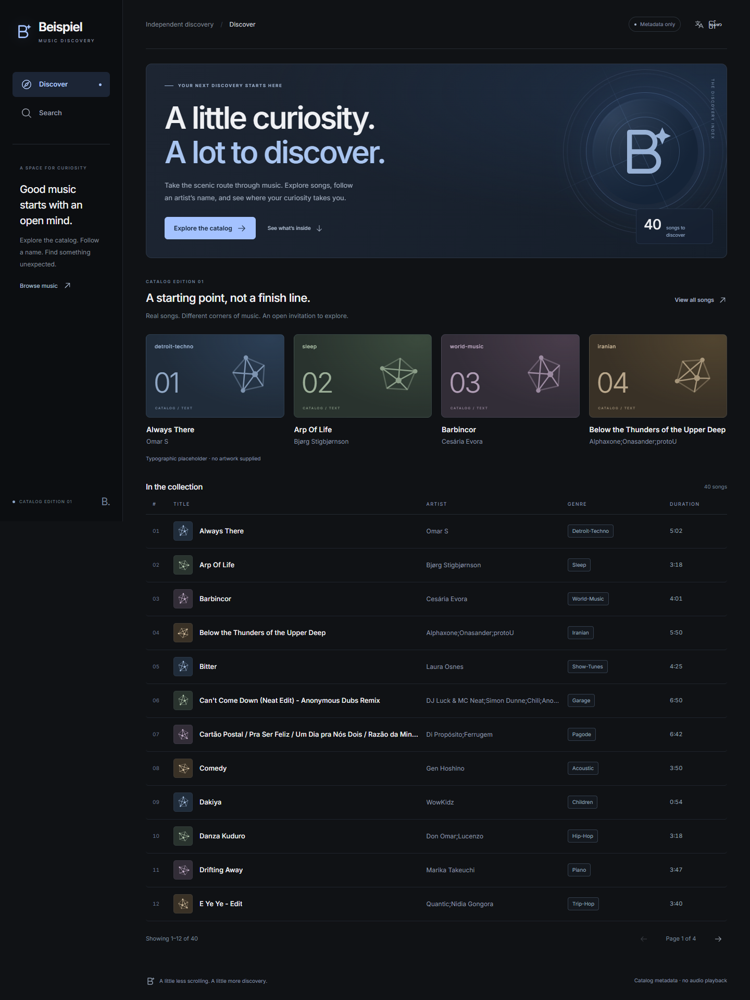
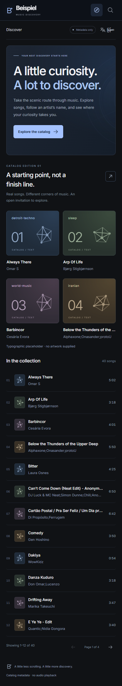

# Beispiel — Music discovery website (M04)

A React/TypeScript music catalog website connected to the existing Express API. **Beispiel** is the application name. Its original B monogram and decorative discovery constellations are UI marks, not album artwork.

Browse the 40-song catalog, search song titles or artist text, and open real song details. The site is metadata-only: no authentication, playlists, audio, or recommendation integration is implemented in M04.

## Open the website

Development URL: **http://127.0.0.1:5173/**

Both the API (port 4000) and frontend (5173) were left running for review. If they are still running, open the URL rather than launching duplicate servers.

### Terminal 1 — Express API

~~~powershell
Set-Location -LiteralPath 'D:\music_recommendation_app\api'
npm run dev
~~~

### Terminal 2 — React website

~~~powershell
Set-Location -LiteralPath 'D:\music_recommendation_app\app'

# Dependencies are already installed. Use this on a fresh checkout:
npm ci

# Optional: defaults already match .env.example.
if (-not (Test-Path -LiteralPath '.env')) {
    Copy-Item -LiteralPath '.env.example' -Destination '.env'
}

npm run dev
~~~

Keep both terminal windows open. Stop a process you started using Ctrl+C in its terminal. Ports are fixed: if 4000 or 5173 is occupied, use/stop the existing project server instead of accidentally running a second copy.

The API must already have its M03 database/import setup. It does not need a Python HTTP service for these pages.

## Things to try

1. Open Discover. Browse the typographic catalog tiles and song rows.
2. Use Previous/Next to browse the catalog; Search shows all 40 songs over pages of 12, 12, 12, and 4.
3. Open Search and type **Comedy**. The query updates after about 300 ms, or immediately when you submit.
4. Switch to **Artists** and search **Hoshino**. This finds songs matching the stored artist text, not a separate artist account.
5. Click a song to see its album text, genre, duration, source popularity, content label, and original source ID.
6. Follow “Explore this artist” to a real artist-text query.
7. Refresh a detail URL; it remains on the correct page.
8. Try a nonexistent query or URL to inspect empty/not-found states.
9. Use the language button for the English/Burmese core interface.
10. Stop your API temporarily and refresh Search; the page offers a retry instead of showing raw errors. Restart the API and choose Try again.

Client navigation uses React Router links, not full document reloads. Search mode, text, and page are in the URL, so queries can be bookmarked. Incoming unsupported browser page values normalize to page 1.

## Required stack and preset limitation

Implemented: React, TypeScript, Vite, React Router, TanStack Query, Tailwind, i18next/react-i18next, Base UI primitives, Phosphor icons, and self-hosted Inter.

The exact approved shadcn/ui preset **beEhfqy2 was attempted twice**:

- npx shadcn@latest init --preset beEhfqy2 --yes --no-monorepo
- npx shadcn@4.22.0 init --preset beEhfqy2 --yes --no-monorepo

Both official CLI attempts failed with Connect Timeout Error while contacting ui.shadcn.com/init. No preset files were generated. Because the request explicitly allowed the preset “if available,” development continued using a documented local fallback.

The current dark zinc/blue theme and components/ui/button.tsx are **not an installed shadcn preset**. The button wraps the real Base UI primitive with a small local variant layer; it is not a copied/generated shadcn component. design-status.json records the limitation.

When the registry becomes reachable, retry the exact preset in a reviewed change. Do not silently replace the fallback or assume components.json already exists. The pages/API client are separate from this UI layer to keep that change manageable.

## API connection: no backend contract changes

M03 did not expose cross-origin headers. To preserve the API entirely, Vite forwards browser requests to it:

~~~text
Browser http://127.0.0.1:5173/api/v1/search
    -> Vite proxy
    -> http://localhost:4000/api/v1/search
~~~

.env.example therefore uses:

~~~text
VITE_API_BASE_URL=/api/v1
API_PROXY_TARGET=http://localhost:4000
~~~

This is a deliberate local configuration difference from the roadmap's example of an absolute browser API URL. The same M03 endpoints, parameters, and JSON contracts are used unchanged. No CORS middleware or other backend modification was required.

VITE_ settings are public browser configuration; do not place secrets there. API_PROXY_TARGET is read by Vite's server configuration. Restart Vite after editing environment settings.

The local production preview also has the proxy. For actual static hosting later, configure an equivalent same-origin /api reverse proxy, or explicitly add an approved CORS/origin setup to the backend. Deploying these files alone does not create a hosted API.

## Important files in plain language

| File | Purpose |
| --- | --- |
| src/main.tsx | Starts React and creates one router/query client |
| src/router.tsx | Maps /, /search, /tracks/:id, and missing pages to screens |
| src/components/Layout.tsx | Shared navigation, language control, page frame, and footer |
| src/pages/Home.tsx | Live catalog overview with API-derived count and pagination |
| src/pages/Search.tsx | Search form, 300 ms debounce, song/artist mode, and URL state |
| src/pages/TrackDetail.tsx | Shows only the selected API record's metadata |
| src/pages/NotFound.tsx | Missing-page and unexpected route-error recovery |
| src/lib/api.ts | Typed HTTP requests, safe API errors, page parsing, and duration formatting |
| src/lib/queryClient.ts | TanStack Query cache/retry defaults |
| src/components/TrackCard.tsx | Shared song row/card presentation and internal detail links |
| src/components/Pagination.tsx | Previous/Next controls using actual API metadata |
| src/components/PageState.tsx | Loading skeletons, empty results, and error/retry UI |
| src/components/ui/button.tsx | Explicit local accessible fallback UI primitive |
| src/i18n.ts, src/locales/ | Translation setup and English/Burmese dictionaries |
| src/index.css | Dark theme, responsive layouts, motion preferences, and focus styles |
| vite.config.ts | React/Tailwind plugins, local ports, and same-origin API proxy |
| vitest.config.ts, src/test/ | Frontend component/helper tests |
| design-status.json | Honest record of the unavailable approved preset |
| public/INTER-LICENSE.txt | License supplied with the self-hosted font |

### Concepts

**Component:** a reusable piece of interface, such as one song row or an error panel.

**React Router:** changes which screen is displayed when a URL changes, without requesting a whole new HTML document.

**TanStack Query:** manages server-data loading, caching, errors, cancellation, and refetch. It does not own URLs or authentication.

**Local state:** temporary input text while you type. After debounce/submit, committed search parameters go into the URL and trigger the matching query.

**Proxy:** forwards a request from the local website server to Express, allowing the browser to use one origin.

## Honest metadata and accessible behavior

All displayed tracks come from the API. Typographic tiles use a decorative constellation, index, and real genre; they are explicitly identified as placeholders. They are not invented album covers. No remote artwork, fabricated preview URL, audio file, or playback control is included.

Missing metadata is shown as Not provided or an em dash. Source popularity is labeled as a historical dataset score, not a live chart. No personalized/AI recommendation claim is made yet.

The responsive layout was inspected at desktop, 390 px mobile, and 360 px Burmese mobile widths with no horizontal overflow. Keyboard focus and skip navigation were checked. Core English/Burmese keys are aligned; M13 remains the later full localization/polish checkpoint, not a claim of a complete accessibility or translation audit.

Inter is self-hosted through its npm package, with its license copied into public/. UI icons are package-provided; the favicon/orbit decoration are simple original UI marks, not music metadata.

## Tests, type checking, and production build

~~~powershell
Set-Location -LiteralPath 'D:\music_recommendation_app\app'
npm test
npm run typecheck
npm run build
~~~

Frontend tests: **12 passed**. They cover catalog navigation, debounced song search, artist mode, URL pagination, empty/reset, failure/retry, loading, missing songs/pages, nullable metadata, absent audio/artwork, locale-key coverage, and helpers.

The existing API regression suite also passed **all 50 tests**. API/Python source and the SQLite data remain unchanged.

Real Chrome checks used the running API: all 40 unique songs over four pages, actual artist matches, details, direct-route refresh, no-reload navigation, missing/empty states, blocked-request retry, mobile/Burmese layout, and keyboard skip navigation. The production build was also served and checked.

### Preview the compiled website

After building, with the API running:

~~~powershell
npm run preview
~~~

Open http://127.0.0.1:4173. This is a local verification server, not a deployment. Stop it with Ctrl+C when finished. Host configuration must provide SPA fallback so direct detail/search URLs return the app's index.html.

## Scope and next gate

No Python files, API contracts/code, existing catalog records, SPEC.md, or ROADMAP.md were changed. No repository or external hosted Site was created.

M04 ends here. **M05 requires explicit approval.** It will wrap the existing Python engine in a private HTTP service; M06 will connect website song recommendations through Express.
